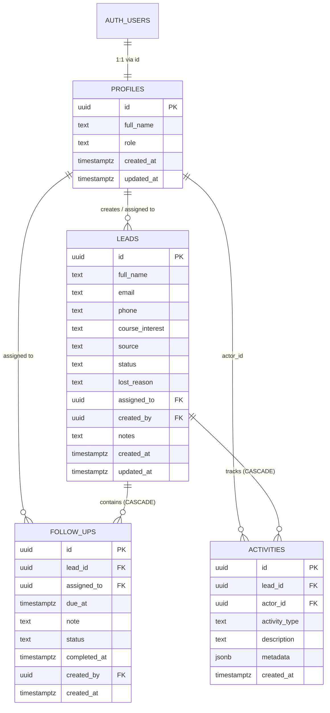

# BrightPath CRM — System Architecture & Design Specification

This document provides a comprehensive technical overview of the **BrightPath CRM** architecture, data modeling, authentication lifecycle, Row Level Security (RLS) enforcement, and client-side design patterns.

---

## 1. System Topology & Architecture Overview

BrightPath CRM is built as a cloud-native Single Page Application (SPA) leveraging **React 19**, **TypeScript**, **Vite**, and **Tailwind CSS**, with **Supabase (PostgreSQL 15+)** providing authentication, database persistence, and fine-grained Row Level Security.

```
┌────────────────────────────────────────────────────────────────────────┐
│                              CLIENT TIER                               │
│                                                                        │
│   ┌────────────────────────────────────────────────────────────────┐   │
│   │                 React 19 Single Page App (SPA)                 │   │
│   │                                                                │   │
│   │  ┌──────────────┐  ┌──────────────┐  ┌──────────────────────┐  │   │
│   │  │ ErrorBoundary│  │ AuthContext  │  │     ToastContext     │  │   │
│   │  └──────┬───────┘  └──────┬───────┘  └──────────┬───────────┘  │   │
│   │         │                 │                     │              │   │
│   │  ┌──────┴─────────────────┴─────────────────────┴───────────┐  │   │
│   │  │                 React Router v7 Route Tree               │  │   │
│   │  │  • /login   • /   • /leads   • /leads/:id                │  │   │
│   │  │  • /followups     • /reports • /settings                 │  │   │
│   │  └────────────────────────┬─────────────────────────────────┘  │   │
│   │                           │                                    │   │
│   │  ┌────────────────────────┴─────────────────────────────────┐  │   │
│   │  │           Feature Hooks & Service Client Layer           │  │   │
│   │  │  • useLeads    • useFollowups    • useMetrics            │  │   │
│   │  │  • useAuth     • useActivities   • useToast              │  │   │
│   │  └────────────────────────┬─────────────────────────────────┘  │   │
│   └───────────────────────────┼────────────────────────────────────┘   │
└───────────────────────────────┼────────────────────────────────────────┘
                                │ HTTPS / PostgREST API
                                ▼
┌────────────────────────────────────────────────────────────────────────┐
│                        SUPABASE / POSTGRESQL TIER                      │
│                                                                        │
│   ┌────────────────────────────────────────────────────────────────┐   │
│   │                         GoTrue Auth                            │   │
│   │   JWT Verification • Session Tokens • Password Hashing (Argon2)│   │
│   └───────────────────────────┬────────────────────────────────────┘   │
│                               │ auth.uid() context                     │
│                               ▼                                        │
│   ┌────────────────────────────────────────────────────────────────┐   │
│   │               PostgreSQL Database & RLS Engine                 │   │
│   │                                                                │   │
│   │  ┌──────────────┐  ┌──────────────┐  ┌──────────────────────┐  │   │
│   │  │   profiles   │  │    leads     │  │      follow_ups      │  │   │
│   │  └──────┬───────┘  └──────┬───────┘  └──────────┬───────────┘  │   │
│   │         │                 │                     │              │   │
│   │         └─────────────────┼─────────────────────┘              │   │
│   │                           ▼                                    │   │
│   │                  ┌─────────────────┐                           │   │
│   │                  │   activities    │                           │   │
│   │                  └─────────────────┘                           │   │
│   │                                                                │   │
│   │  Row Level Security Policies:                                  │   │
│   │  • Admins / Managers: Full tenant visibility                   │   │
│   │  • Counsellors: Filtered strictly to assigned/created records  │   │
│   │                                                                │   │
│   │  Database Triggers:                                            │   │
│   │  • on_auth_user_created: Synchronizes auth.users to profiles   │   │
│   │  • tr_prevent_role_escalation: Prevents self-privilege ascent  │   │
│   │  • tr_leads_updated_at: Maintains accurate timestamps          │   │
│   └────────────────────────────────────────────────────────────────┘   │
└────────────────────────────────────────────────────────────────────────┘
```

---

## 2. Component Hierarchy & State Strategy

The application adopts a uni-directional state flow combining **React Context** for global sessions and toasts with **custom hooks** for domain data caching and synchronization.

```
App
 └── ErrorBoundary (catches render exceptions, provides recovery UI)
      └── AuthProvider (manages session state, profile caching, login/logout)
           └── ToastProvider (global notification queue with auto-dismiss)
                └── BrowserRouter
                     └── Routes
                          ├── Public Route: /login (LoginPage)
                          └── ProtectedRoute (guards unauthenticated requests)
                               └── Layout (responsive shell, navigation state)
                                    ├── Header (search, current profile, sign-out)
                                    ├── Sidebar (desktop navigation, active indicator)
                                    ├── MobileNav (bottom bar navigation for smartphones)
                                    └── Outlet (page content)
                                         ├── DashboardPage (useMetrics, KpiCard, Widgets)
                                         ├── LeadsPage (useLeads, LeadTable, LeadFilterBar)
                                         ├── LeadDetailPage (leadsService, FollowupCard, Timeline)
                                         ├── FollowupsPage (useFollowups, tabbed queue)
                                         ├── ReportsPage (useMetrics, CSV export)
                                         └── SettingsPage (authService, profile edit)
```

### State Management Separation
- **Session State**: Managed in `AuthContext.tsx`. Tracks Supabase `Session`, `User`, `Profile`, and computed role (`admin`, `manager`, `counsellor`).
- **UI Feedback State**: Managed in `ToastContext.tsx`. Thread-safe, non-blocking toast alerts with automatic 4.5-second timer dismissal.
- **Data Querying & Mutations**: Encapsulated in custom hooks (`useLeads`, `useFollowups`, `useMetrics`, `useActivities`). Hooks coordinate loading flags, error boundaries, client filtering, and optimistic state updates.

---

## 3. Master Database Schema & Relationships

### Entity-Relationship Diagram



### Table Definitions & Integrity Constraints

1. **`profiles`**
   - Linked 1:1 with `auth.users(id)` via foreign key with `ON DELETE CASCADE`.
   - Role constrained by `CHECK (role IN ('admin', 'manager', 'counsellor'))`.
   - Protected against privilege escalation by `tr_prevent_role_escalation`.

2. **`leads`**
   - Core admissions pipeline entity.
   - Status constrained by `CHECK (status IN ('New', 'Contacted', 'Qualified', 'Converted', 'Lost'))`.
   - Source constrained by `CHECK (source IN ('Website', 'Walk-in', 'Phone Call', 'Referral', 'Social Media', 'Other'))`.
   - `lost_reason` field populated whenever status transitions to `Lost`.

3. **`follow_ups`**
   - Interaction schedules with explicit `due_at` timestamp.
   - Status constrained by `CHECK (status IN ('pending', 'completed', 'cancelled'))`.
   - Foreign key cascade on `lead_id` ensures zero orphaned callback reminders.

4. **`activities`**
   - Immutable audit trail.
   - Activity types: `created`, `status_change`, `note`, `followup_created`, `followup_completed`.
   - Includes structured `metadata` JSONB for deep history tracking (e.g., `{"old_status": "New", "new_status": "Contacted"}`).

---

## 4. Row Level Security (RLS) Policy Architecture

All tables enforce Row Level Security (`ALTER TABLE ... ENABLE ROW LEVEL SECURITY`). The database server evaluates the active caller's JWT token (`auth.uid()`) against the following policy rules:

```
                  Client Request + JWT Bearer
                              │
                              ▼
                   Evaluate auth.uid() in DB
                              │
            ┌─────────────────┴─────────────────┐
            │                                   │
      role = 'admin'                      role = 'counsellor'
      or 'manager'                              │
            │                                   ▼
            ▼                        Filter strictly:
     Full Access Permitted           • assigned_to = auth.uid() OR
     across all records              • created_by = auth.uid()
```

### Policy Rules Matrix

| Table | Operation | Admin / Manager | Counsellor |
| :--- | :--- | :--- | :--- |
| **`profiles`** | `SELECT` | All Profiles | All Profiles (needed for assignee tags) |
| **`profiles`** | `UPDATE` | Self / All | Self only (`full_name` only; role locked) |
| **`leads`** | `SELECT` | All Leads | Leads where `assigned_to = uid` OR `created_by = uid` |
| **`leads`** | `INSERT` | Any Lead | Any Lead (auto-sets `created_by = uid`) |
| **`leads`** | `UPDATE` | Any Lead | Assigned leads only (cannot reassign to others) |
| **`leads`** | `DELETE` | Allowed | Denied (403 Forbidden by RLS) |
| **`follow_ups`**| `SELECT` | All Follow-ups | Follow-ups on accessible leads |
| **`follow_ups`**| `INSERT` | Any Follow-up | Follow-ups on accessible leads |
| **`follow_ups`**| `UPDATE` | Any Follow-up | Follow-ups where `assigned_to = uid` |
| **`activities`** | `SELECT` | All Activities | Activities on accessible leads |
| **`activities`** | `INSERT` | Allowed | Allowed (logs own actions) |

---

## 5. Admissions Funnel State Machine

The student enquiry pipeline enforces a structured lifecycle:

```
            ┌──────────────┐
            │     NEW      │ ◄── Initial Enquiry Registered
            └──────┬───────┘
                   │ First outreach call / email
                   ▼
            ┌──────────────┐
     ┌─────►│  CONTACTED   │
     │      └──────┬───────┘
     │             │ Counselling meeting & academic review
     │             ▼
     │      ┌──────────────┐
     │      │  QUALIFIED   │
     │      └──────┬───────┘
     │             │
     │      ┌──────┴──────────────────────┐
     │      │ Final Decision              │
     │      ▼                             ▼
     │ ┌──────────────┐            ┌──────────────┐
     │ │  CONVERTED   │            │     LOST     │
     │ │  (Enrolled)  │            │ (Reason Req) │
     │ └──────────────┘            └──────┬───────┘
     │                                    │
     └────────────────────────────────────┘
         Re-engagement / Second chance enquiry
```

### Business Rules Enforced
1. **Mandatory Lost Reason**: Transitions to `Lost` require a descriptive reason stored in `leads.lost_reason`.
2. **Audit Activity Generation**: Every status change generates an automatic entry in the `activities` table noting previous status, new status, timestamp, and the actor's user ID.
3. **Re-engagement Support**: Lost leads can be reopened if the candidate reaches back out, retaining previous history in the audit trail.

---

## 6. Metric Reconciliation Standard

To maintain absolute credibility, the system implements strict mathematical reconciliation:

1. **Total Accessible Leads**: $\sum \text{leads}$ visible to the user's role.
2. **New Leads**: Count of leads where $\text{status} = \text{'New'}$.
3. **Converted Admissions**: Count of leads where $\text{status} = \text{'Converted'}$.
4. **Overdue Follow-ups**: Count of follow-ups where $\text{status} = \text{'pending'}$ AND $\text{due\_at} < \text{now()}$.
5. **Conversion Rate**:
   $$\text{Conversion Rate} = \begin{cases} 0\% & \text{if Total Leads} = 0 \\ \operatorname{round}\left(\frac{\text{Converted}}{\text{Total Leads}} \times 100, 1\right) & \text{otherwise} \end{cases}$$

---

## 7. Performance & Security Best Practices

- **Zero Client Mocking**: All data loads directly from PostgreSQL via Supabase PostgREST client.
- **Prepared Parameterized Queries**: Supabase client automatically parameterizes all inputs, preventing SQL injection.
- **Content Security**: All text renders via React JSX text nodes, preventing Cross-Site Scripting (XSS).
- **Graceful Error Recovery**: Top-level `ErrorBoundary` prevents application crashes, while per-page error alerts display actionable feedback.
- **Accessible ARIA Patterns**: Modal dialogs trap focus, toast notifications notify assistive technologies via `aria-live="polite"`, and buttons maintain visible keyboard focus rings.
